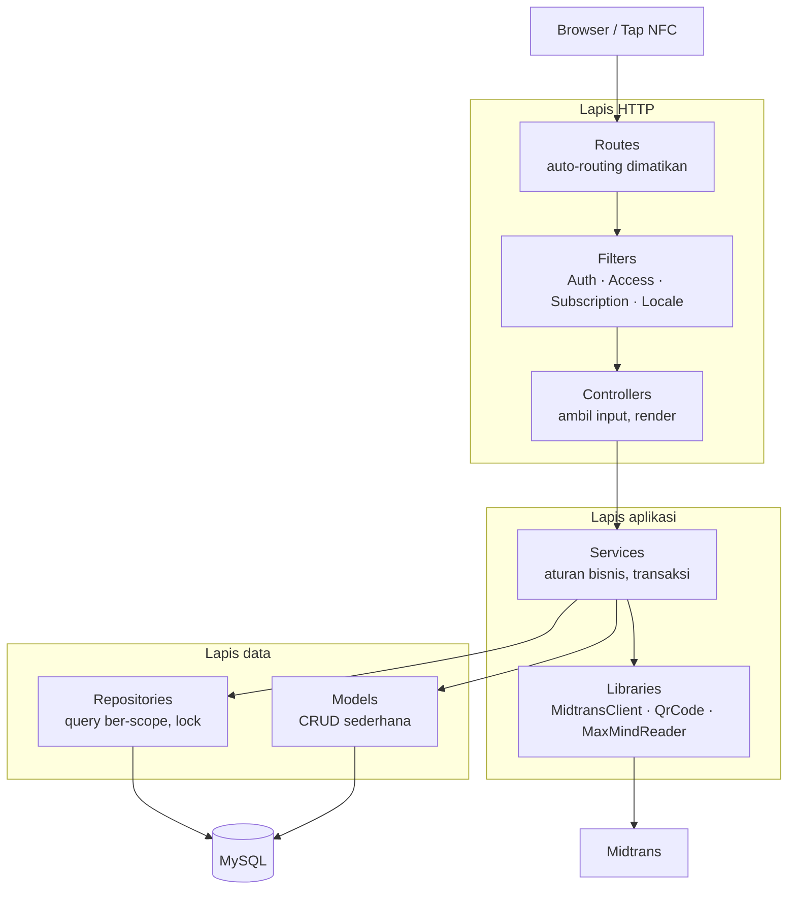
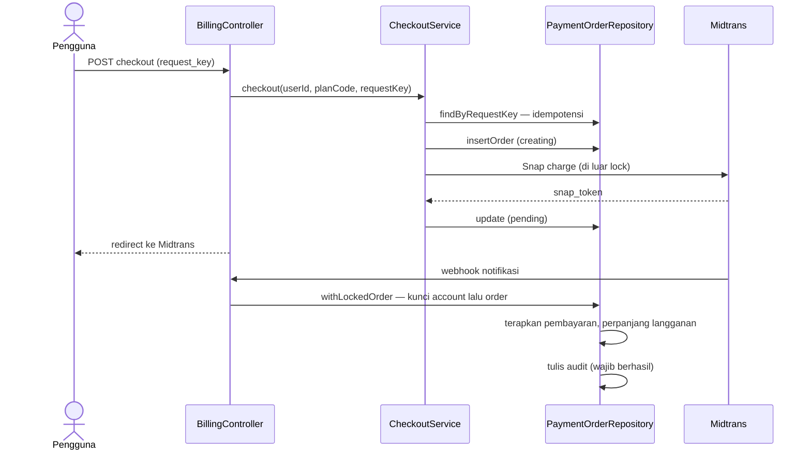

# NFC Digital Card

Aplikasi kartu nama digital: satu tap NFC atau satu pindai QR membuka halaman kartu, lengkap dengan kontak, galeri, dan tautan sosial. Dibangun di atas CodeIgniter 4 dengan lapisan service dan repository, pembayaran Midtrans, langganan berjenjang, dan panel admin.

[](https://github.com/daffa032/apps-nfc-ci/actions/workflows/ci.yml)
[](https://php.net)
[](https://codeigniter.com)
[](phpstan.neon.dist)
[](LICENSE)

---

## Daftar isi

- [Fitur](#fitur)
- [Arsitektur](#arsitektur)
- [Alur pembayaran](#alur-pembayaran)
- [Keputusan teknis](#keputusan-teknis)
- [Keamanan](#keamanan)
- [Struktur proyek](#struktur-proyek)
- [Menjalankan secara lokal](#menjalankan-secara-lokal)
- [Pengujian dan kualitas](#pengujian-dan-kualitas)
- [Dokumentasi lanjutan](#dokumentasi-lanjutan)

---

## Fitur

| Domain | Kemampuan |
| --- | --- |
| **Kartu digital** | Halaman kartu publik, halaman berbagi ber-QR, profil, galeri foto, tautan sosial, aset merek, kartu dua bahasa (ID/EN) |
| **Template** | Katalog template Basic dan Pro, unggah HTML kustom lewat sanitizer allowlist, 12 desain Pro bawaan |
| **Pembayaran** | Checkout Midtrans Snap, webhook notifikasi, rekonsiliasi terjadwal, pembatalan, riwayat tagihan |
| **Langganan** | Paket berjenjang, versi harga, pemberian akses, pengingat perpanjangan dan kuitansi otomatis |
| **Statistik** | Hitungan tampilan dan klik kontak, pengunjung unik tanpa menyimpan IP mentah, agregat harian |
| **Admin** | Manajemen pengguna dan admin, master data paket/template, pemantauan pembayaran, penangguhan akun |
| **Audit** | Activity log append-only untuk aksi sensitif |

## Arsitektur

Rantai permintaan berjalan satu arah: setiap lapis hanya mengenal lapis di bawahnya.



Tanggung jawab tiap lapis:

- **Routes** — auto-routing dimatikan; setiap URI dideklarasikan eksplisit per metode HTTP. Otorisasi dinyatakan sebagai struktur grup bersarang, sehingga hak akses terbaca dari berkas rute.
- **Filters** — autentikasi sesi, pemeriksaan role, pemeriksaan langganan aktif, dan locale. Penolakan akses ditulis ke audit log.
- **Controllers** — tipis. Mengambil input, memanggil service, merender view. Tidak memuat SQL.
- **Services** — tempat aturan bisnis, transaksi, dan koordinasi. Dependensi di-inject lewat constructor dengan nilai default, sehingga dapat diuji tanpa container.
- **Repositories** — query dengan scope kepemilikan atau role, transaksi lintas tabel, dan locking. Menerima koneksi, mengembalikan array; tidak pernah mengembalikan query builder dan tidak pernah membaca session atau request.
- **Models** — CI4 Model untuk CRUD sederhana saja.

### Contoh alur vertikal

`POST dashboard/billing/checkout` menempuh jalur berikut:

```
Routes.php  →  filter auth  →  BillingController::checkout()
            →  CheckoutService::checkout($userId, $planCode, $requestKey, $now)
                 ├─ AccountRepository::find()           cek role dan status akun
                 ├─ findByRequestKey()                  idempotensi
                 ├─ CancelPaymentService                tutup order terbuka lain
                 ├─ insertOrder()                       status "creating" + snapshot harga
                 ├─ MidtransClient::snap()              dipanggil di luar lock DB
                 └─ update status "pending" + token
            →  audit log  →  redirect ke host Midtrans yang di-allowlist
```

## Alur pembayaran

Pembayaran adalah bagian paling rawan balapan: notifikasi webhook dan pengecekan status dari pengguna bisa tiba bersamaan.



Kuncinya: `PaymentOrderRepository::withLockedOrder()` mengunci baris account lalu order dalam urutan tetap di satu transaksi, sehingga pembayaran diterapkan **tepat satu kali** meski notifikasi dan pengecekan status tiba bersamaan.

## Keputusan teknis

Beberapa pilihan yang dibuat sadar, beserta alasannya:

- **Repository hanya untuk yang membutuhkan.** Dibuat saat ada query ber-scope pemilik, transaksi lintas tabel, locking, agregat admin, atau tabel append-only. Bukan satu repository per tabel — karena itu hanya ada 15 repository untuk puluhan tabel.
- **Tanpa interface per repository.** Repository adalah kelas konkret. Abstraksi tambahan tidak dibuat sampai ada kebutuhan nyata seperti implementasi pengganti.
- **Audit log append-only.** `AuditLogRepository` sengaja tidak memiliki metode update atau delete. Lebih jauh, `withRequiredAudit()` membatalkan aksi bila penulisan audit gagal — aksi sensitif tidak boleh terjadi tanpa jejak.
- **Idempotensi checkout.** `request_key` unik per pengguna. Pengguna yang menekan tombol dua kali atau percobaan ulang jaringan tidak menghasilkan dua transaksi.
- **Backoff eksponensial.** Rekonsiliasi order yang gagal mundur `5 menit × 2^kegagalan`, dibatasi 6 jam, dihitung langsung di SQL.
- **Panggilan jaringan di luar transaksi.** Permintaan Snap dilakukan di luar lock database agar koneksi lambat tidak menahan baris terkunci.
- **Statistik tanpa menyimpan IP.** Pengunjung unik diidentifikasi lewat HMAC dengan metadata yang berganti harian; IP dan user-agent mentah tidak pernah disimpan.

## Keamanan

- **CSRF global**, dengan tepat dua pengecualian beralasan: beacon statistik kartu (memakai token per-kartu) dan webhook Midtrans (diverifikasi lewat tanda tangan SHA-512 dengan `hash_equals`).
- **Otorisasi berbasis kepemilikan.** Kepemilikan selalu menjadi parameter eksplisit, misalnya `findOwnedOrder($code, $userId)`. Order milik pengguna lain menghasilkan 404, bukan 403 — status 403 akan membocorkan bahwa order itu ada.
- **Sanitizer HTML allowlist** untuk unggahan template: batas 100 KB, 100 elemen, kedalaman 16; tag dan class dibatasi daftar; keluaran dibangun ulang dari DOM, bukan dari sumber mentah; divalidasi ulang setiap render.
- **Validasi unggahan** berlapis: `isValid()`, ukuran maksimum 5 MB, dan `getimagesize()` untuk memastikan berkas benar-benar gambar.
- **Rate limiting** pada aksi pembayaran, 6 permintaan per menit per pengguna.
- **Redirect gateway dibatasi allowlist host**, sehingga parameter tidak dapat dipakai untuk open redirect.
- `password_hash` / `password_verify`, token reset 32 byte acak sekali pakai, serta pencabutan sesi lewat `session_version`.

## Struktur proyek

```
app/
├── Config/Routes.php      Deklarasi rute eksplisit, otorisasi lewat grup bersarang
├── Filters/               Auth, Access (role), Subscription, Locale
├── Controllers/           18 controller tipis
├── Services/              36 service dalam 9 domain — aturan bisnis
│   ├── Auth/              Login, reset password
│   ├── Cards/             Profil, galeri, template, render kartu publik
│   ├── Payments/          Checkout, apply, cancel, notifikasi tagihan
│   └── Users/             Manajemen akun dan admin
├── Repositories/          15 repository — query ber-scope, transaksi, lock
├── Models/                5 model untuk CRUD sederhana
├── Libraries/             MidtransClient, QrCode, MaxMindReader, AppMailer
├── Commands/              payments:reconcile, billing:notify, analytics:purge, geoip:update
├── Database/Migrations/   24 migration
└── Views/                 Layout, partial, template kartu

tests/
├── unit/                  39 berkas — service, sanitizer, QR, mailer
├── database/              3 berkas — integrasi repository terhadap MySQL nyata
└── session/               1 berkas

Dockerfile, compose.yaml, nginx.conf   Stack dev: Nginx → PHP-FPM → MariaDB + phpMyAdmin
```

## Menjalankan secara lokal

Dibutuhkan PHP 8.3 dengan ekstensi `intl`, `mbstring`, `mysqli`, serta MySQL 8 atau MariaDB 10.5+.

```bash
composer install
cp .env.example .env
# Isi kredensial database di .env
php spark migrate --all
php spark serve
```

### Menjalankan dengan Docker (app + database + phpMyAdmin)

Setup ini jalankan seluruh stack dev: Nginx (pintu masuk tunggal) → PHP-FPM
(aplikasi) → MariaDB, plus phpMyAdmin — empat container, satu perintah. Ini
**bukan** gambaran deployment produksi (yang tetap di cPanel, lihat
[DEPLOYMENT.md](guides/DEPLOYMENT.md)); image ini dioptimalkan untuk iterasi
lokal, bukan untuk dikirim ke server.

```bash
cp .env.docker.example .env.docker
# Ganti kedua kata sandi contoh dengan nilai acak yang berbeda sebelum melanjutkan.

cp .env.example .env
# Edit .env (dipakai saat `composer test`/`php spark` jalan langsung di host):
# database.default.hostname = 127.0.0.1, port = 3307, password sesuai .env.docker.

cp .env.docker-app.example .env.docker-app
# Edit .env.docker-app (satu-satunya yang dibaca APLIKASI di dalam Docker;
# lihat compose.yaml — mounted sebagai /app/.env, menimpa bind-mount di atas):
# database.default.hostname = database, port = 3306, password sama dengan di atas.

docker compose --env-file .env.docker up -d --wait
docker compose --env-file .env.docker exec app php spark migrate --all
```

Dua file `.env*` database itu sengaja terpisah: CodeIgniter membaca nilai
`.env` ke dalam `$_ENV`, dan `env()` mengutamakan `$_ENV` di atas variabel
sistem — jadi satu file tidak bisa menyimpan dua hostname database sekaligus
(`database` untuk jaringan Docker vs `127.0.0.1` untuk akses dari host).

Lalu buka:

- **http://localhost:8080/** — aplikasi (satu-satunya port yang perlu dibuka: Nginx di depan)
- **http://localhost:8080/phpmyadmin/** — phpMyAdmin (server `database`, pengguna `nfc_user`)
- `127.0.0.1:3307` — akses database langsung dari tool eksternal di host (DBeaver, HeidiSQL, dll), terpisah dari port Nginx

24 migration membangun baseline lima tabel lama lebih 14 tabel tambahan serta
katalog awal. Periksa `docker compose --env-file .env.docker exec app php spark migrate:status`
setelah selesai. **Jangan impor `qrcode_system.sql` ke `nfc_local` sebelum
menjalankan migration**: dump tersebut sudah berisi schema akhir dan data
privat, termasuk tabel riwayat migration. Bila ingin memulihkan dump lama,
gunakan database terpisah melalui Import di phpMyAdmin, periksa backup dan
konfigurasi strict/zero-date dahulu; jangan jalankan `migrate:refresh` atau
reset riwayat migration pada dump. Berkas gambar yang dirujuk dump harus
dipulihkan secara terpisah.

**Jangan jalankan `php spark serve` langsung di Windows sambil stack ini
jalan** — keduanya akan berebut port 8080 (Nginx sudah memakainya). Matikan
stack (`docker compose --env-file .env.docker down`) dulu bila sesekali perlu
`spark serve` manual; `.env` host tetap siap pakai untuk kasus itu.

`composer test`/`lint`/`analyse` tetap dijalankan di host seperti biasa
(lihat [Pengujian dan kualitas](#pengujian-dan-kualitas)) — image `app` di
Docker di-build dengan `--no-dev`, jadi PHPUnit/PHPStan/php-cs-fixer sengaja
tidak ada di dalamnya.

Hentikan layanan tanpa menghapus data: `docker compose --env-file .env.docker down`.
Volume database dan upload tetap tersimpan. Jangan gunakan `down -v` untuk
database berisi data. Setelah mengubah `Dockerfile`/`composer.lock`, build
ulang image: `docker compose --env-file .env.docker up -d --build`.

Langkah konfigurasi selengkapnya — `app.baseURL`, pengaturan tagihan, cron statistik, dan document root — ada di [panduan deployment](guides/DEPLOYMENT.md).

## Pengujian dan kualitas

```bash
composer test         # PHPUnit
composer lint         # php-cs-fixer, standar CodeIgniter 4
composer analyse      # PHPStan
composer audit:deps   # pemindaian CVE dependensi
composer check        # keempatnya sekaligus
```

**251 tes, 1118 assertion.** Dua puluh sembilan di antaranya adalah tes integrasi repository yang berjalan terhadap MySQL sungguhan; tes itu dilewati bila MySQL tidak tersedia, dan dijalankan penuh di CI.

Yang diuji tes integrasi bukan hal yang mudah dipalsukan dengan mock: scoping kepemilikan, cascade delete, periode langganan yang tidak boleh tumpang-tindih, super-admin terakhir yang tidak dapat dihapus, atomicity statistik, serta sembilan skenario pembayaran termasuk idempotensi dan backoff.

Setiap push dan pull request menjalankan empat gate — gaya kode, analisis statis, audit dependensi, dan tes — terhadap MySQL 8 di GitHub Actions. Branch `master` dan `develop` dilindungi dan menuntut keempatnya hijau.

## Dokumentasi lanjutan

| Dokumen | Isi |
| --- | --- |
| [Arsitektur](guides/ARCHITECTURE.md) | Lapisan dan urutan refactor |
| [Pengembangan](guides/DEVELOPMENT.md) | Standar penulisan kode |
| [Deployment](guides/DEPLOYMENT.md) | Konfigurasi, migration, cron, document root |
| [Template kartu](guides/TEMPLATES.md) | Unggah, CSS, dan menambah desain baru |
| [Aset](guides/ASSETS.md) | Penataan aset dan CSS |

## Lisensi

[MIT](LICENSE).
